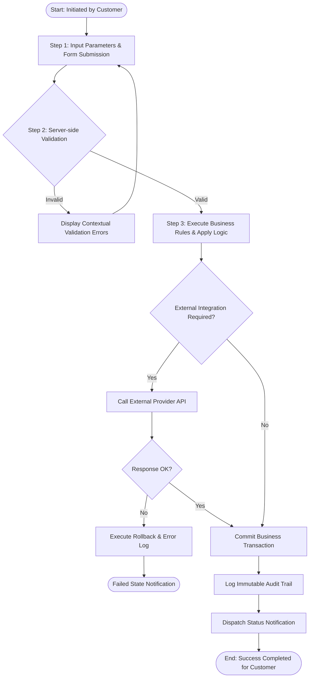

# BUSINESS PROCESS & WORKFLOW MODEL - SMART E-COMMERCE ORDER & INVENTORY SYSTEM

> **Standard**: BPMN / Workflow Modeling Standards  
> **Agent ID**: `ba-01` | **Role**: Business Analyst

---

## 1. Process Landscape Overview
This document formalizes the operational workflows, cross-functional responsibilities, and decision logic.
It guides the System Architect (`sa-01`) for orchestration design and Quality Assurance (`tester-01`) for end-to-end integration tests.

## 2. Process Specification: End-to-End Core Operations Workflow for Smart E-Commerce Order & Inventory System (`BP-001`)
**Overview**: Comprehensive lifecycle workflow governing business transactions initiated by stakeholders in Smart E-Commerce Order & Inventory System.

### 2.1 Process Participants & RACI Assignment

| Participant Role | Swimlane Role | Interaction Scope |
|:---|:---:|:---|
| **Customer** | Core Participant | Initiates, executes, or audits process milestones |
| **System Administrator** | Core Participant | Initiates, executes, or audits process milestones |
| **System Core API** | Core Participant | Initiates, executes, or audits process milestones |
| **Business Rule Engine** | Core Participant | Initiates, executes, or audits process milestones |

### 2.2 Swimlane Action Steps Matrix

| Step # | Responsible Role | Action Performed | Expected Deliverable / Output |
|:---:|:---|:---|:---|
| 1 | **Customer** | Submits operation request via interface with business data | `Encrypted HTTP Request` |
| 2 | **System Core API** | Performs authentication, rate-limiting, and schema validation | `Validated Domain Payload` |
| 3 | **Business Rule Engine** | Executes domain integrity constraints and state transition | `Domain Event` |
| 4 | **System Administrator** | Monitors aggregated transaction dashboard and handles escalations | `Audit Review` |

### 2.3 Enforced Business Rules
- **Rule**: All transactions must be validated server-side prior to persistence.
- **Rule**: Atomic commit with full rollback upon external failure.
- **Rule**: Immutable audit logging for compliance.

### 2.4 Visual Workflow Flowchart (Mermaid)

---
*Document produced by Business Analyst Agent (`ba-01`). No code or database DDL.*