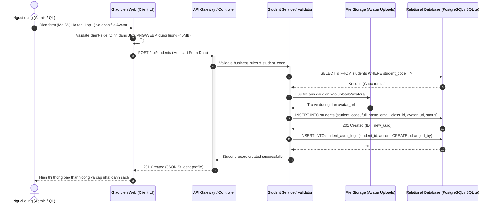
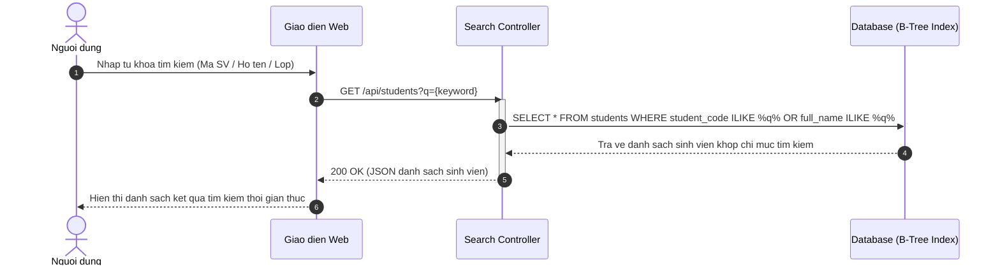
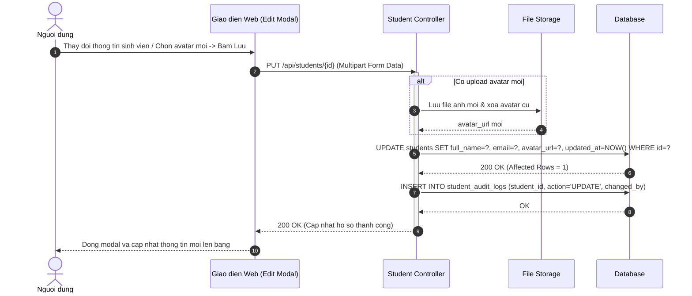
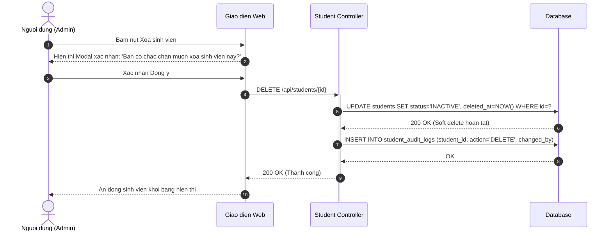
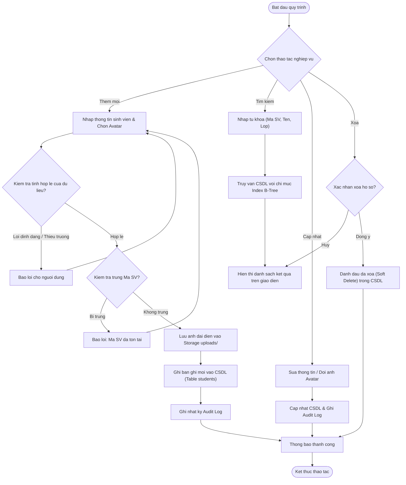

# SOFTWARE REQUIREMENTS SPECIFICATION (SRS) - IEEE 830 STANDARD
## Dự án: Smart E-Commerce Order & Inventory System

> **Tiêu chuẩn áp dụng**: IEEE 830-1998 / ISO/IEC/IEEE 29148:2018  
> **Tác giả (Author)**: Business Analyst AI Agent (`ba-01`)  
> **Phiên bản (Version)**: 1.1.0 (BASELINED SPECIFICATION)  
> **Đối tượng tiếp nhận**: System Architect (`sa-01`), Database Administrator (`dba-01`), Developer (`dev-01`), QA Tester (`tester-01`)

---

## 1. Introduction (Giới thiệu tổng quan)
### 1.1 Purpose (Mục đích tài liệu)
Tài liệu Đặc tả Yêu cầu Phần mềm (SRS) này thiết lập đầy đủ các yêu cầu chức năng (Functional Requirements), yêu cầu phi chức năng (Non-Functional Requirements), các kịch bản tương tác Use Case, sơ đồ tuần tự (Sequence Diagrams) và quy trình nghiệp vụ cho hệ thống **Smart E-Commerce Order & Inventory System**.
Tài liệu này là căn cứ pháp lý và kỹ thuật chuẩn mực phục vụ trực tiếp cho việc:
- **DBA Agent (`dba-01`)**: Thiết kế mô hình CSDL quan hệ chuẩn 3NF và sinh mã nguồn DDL `schema.sql`.
- **Developer Agent (`dev-01`)**: Lập trình cài đặt các API endpoint và giao diện ứng dụng web.
- **QA/Tester Agent (`tester-01`)**: Xây dựng kịch bản kiểm thử tự động (Automation Test Cases).

### 1.2 Document Conventions (Quy ước tài liệu)
- Các mã định danh: `FR-XXX` (Yêu cầu chức năng), `NFR-XXX` (Yêu cầu phi chức năng), `UC-XXX` (Use Case), `BR-XXX` (Quy tắc nghiệp vụ).
- Độ ưu tiên theo MoSCoW: `Must Have` (Bắt buộc), `Should Have` (Nên có), `Could Have` (Có thể có), `Won't Have` (Chưa triển khai).
- Thuật ngữ chuẩn tuân theo RFC 2119: **BẮT BUỘC (SHALL/MUST)**, **KHUYẾN NGHỊ (SHOULD)**.

### 1.3 Product Scope (Phạm vi dự án)
Tài liệu đặc tả yêu cầu nghiệp vụ phần mềm cho Smart E-Commerce Order & Inventory System. Bao gồm 6 yêu cầu chức năng cốt lõi (MoSCoW), 5 chỉ số phi chức năng chuẩn ISO 25010, sơ đồ tuần tự (Sequence Diagrams), sơ đồ quy trình hoạt động, và các kịch bản Use Case chi tiết.

---

## 2. Overall Description (Mô tả tổng quan hệ thống)
### 2.1 Product Perspective (Bối cảnh hệ thống)
Hệ thống **Smart E-Commerce Order & Inventory System** được thiết kế theo kiến trúc Microservices / Web Application hiện đại, phân tầng rành mạch giữa Giao diện (Presentation Layer), Tầng xử lý nghiệp vụ (Business Service Layer) và Tầng lưu trữ CSDL (Data Persistence Layer).

### 2.2 User Classes & Personas (Phân lớp người dùng và phân quyền)
- **Customer**: Tương tác với hệ thống qua giao diện Web Browser hoặc RESTful API, được phân quyền theo cơ chế Role-Based Access Control (RBAC).
- **Store Manager**: Tương tác với hệ thống qua giao diện Web Browser hoặc RESTful API, được phân quyền theo cơ chế Role-Based Access Control (RBAC).
- **Admin**: Tương tác với hệ thống qua giao diện Web Browser hoặc RESTful API, được phân quyền theo cơ chế Role-Based Access Control (RBAC).

### 2.3 Operating Environment (Môi trường vận hành)
- **Server**: Máy chủ Linux / Windows Server chạy môi trường Python 3.11+ / FastAPI runtime.
- **Client**: Trình duyệt web hiện đại (Google Chrome, Microsoft Edge, Cốc Cốc, Firefox, Safari) trên cả Desktop và Mobile.
- **Cơ sở dữ liệu**: PostgreSQL 16+ hoặc SQLite 3 có hỗ trợ toàn vẹn ràng buộc khóa ngoại (Foreign Keys).

### 2.4 Assumptions & Dependencies (Giả định và Phụ thuộc)
- **[ASSUMPTION-001]**: Hệ thống sử dụng cơ sở dữ liệu quan hệ (PostgreSQL hoặc SQLite) có hỗ trợ giao dịch ACID. *(Lý do: Đảm bảo tính toàn vẹn dữ liệu cho các bảng sinh viên, lớp, khoa.)*
- **[ASSUMPTION-002]**: Ảnh đại diện được lưu trữ trên hệ thống file tĩnh của máy chủ và lưu đường dẫn (URL) trong CSDL. *(Lý do: Tối ưu kích thước CSDL và tăng tốc độ tải trang.)*

---

## 3. External Interface Requirements (Yêu cầu giao diện bên ngoài)
### 3.1 User Interfaces (Giao diện người dùng)
Giao diện trực quan, hỗ trợ đầy đủ các thao tác quản trị, tìm kiếm dữ liệu thời gian thực và upload tệp ảnh đại diện theo chuẩn Responsive Web.

### 3.2 Software & Database Interfaces (Giao tiếp phần mềm & CSDL)
- RESTful API endpoints với giao thức HTTP/JSON.
- Xác thực an toàn qua Bearer Token Authorization.
- Chuyển giao dữ liệu thực thể trực tiếp cho Database Administrator Agent (`dba-01`).

---

## 4. System Features & Functional Requirements (Yêu cầu chức năng chi tiết)
### FR-001: Xay dung he thong quan ly don hang va ton kho thuong mai die
- **Mã định danh**: `FR-001`
- **Mức độ ưu tiên**: `Must Have`
- **Phân loại**: Chức năng chính
- **Mô tả chi tiết**: Hệ thống đáp ứng tính năng: Xay dung he thong quan ly don hang va ton kho thuong mai dien tu. Bao gom phan he nguoi dung (User & Role).
- **Đặc tả hành vi**: Hệ thống **BẮT BUỘC (SHALL)** cung cấp chức năng hệ thống đáp ứng tính năng: xay dung he thong quan ly don hang va ton kho thuong mai dien tu. bao gom phan he nguoi dung (user & role).
- **Tiêu chuẩn nghiệm thu**: Người dùng thao tác và nhận được phản hồi thành công từ hệ thống

### FR-002: danh muc san pham (Product & Category)
- **Mã định danh**: `FR-002`
- **Mức độ ưu tiên**: `Must Have`
- **Phân loại**: Chức năng chính
- **Mô tả chi tiết**: Hệ thống đáp ứng tính năng: danh muc san pham (Product & Category).
- **Đặc tả hành vi**: Hệ thống **BẮT BUỘC (SHALL)** cung cấp chức năng hệ thống đáp ứng tính năng: danh muc san pham (product & category).
- **Tiêu chuẩn nghiệm thu**: Người dùng thao tác và nhận được phản hồi thành công từ hệ thống

### FR-003: gio hang (Cart)
- **Mã định danh**: `FR-003`
- **Mức độ ưu tiên**: `Must Have`
- **Phân loại**: Chức năng chính
- **Mô tả chi tiết**: Hệ thống đáp ứng tính năng: gio hang (Cart).
- **Đặc tả hành vi**: Hệ thống **BẮT BUỘC (SHALL)** cung cấp chức năng hệ thống đáp ứng tính năng: gio hang (cart).
- **Tiêu chuẩn nghiệm thu**: Người dùng thao tác và nhận được phản hồi thành công từ hệ thống

### FR-004: don dat hang (Order & OrderItem)
- **Mã định danh**: `FR-004`
- **Mức độ ưu tiên**: `Should Have`
- **Phân loại**: Chức năng chính
- **Mô tả chi tiết**: Hệ thống đáp ứng tính năng: don dat hang (Order & OrderItem).
- **Đặc tả hành vi**: Hệ thống **BẮT BUỘC (SHALL)** cung cấp chức năng hệ thống đáp ứng tính năng: don dat hang (order & orderitem).
- **Tiêu chuẩn nghiệm thu**: Người dùng thao tác và nhận được phản hồi thành công từ hệ thống

### FR-005: thanh toan (Payment Transaction)
- **Mã định danh**: `FR-005`
- **Mức độ ưu tiên**: `Should Have`
- **Phân loại**: Chức năng chính
- **Mô tả chi tiết**: Hệ thống đáp ứng tính năng: thanh toan (Payment Transaction).
- **Đặc tả hành vi**: Hệ thống **BẮT BUỘC (SHALL)** cung cấp chức năng hệ thống đáp ứng tính năng: thanh toan (payment transaction).
- **Tiêu chuẩn nghiệm thu**: Người dùng thao tác và nhận được phản hồi thành công từ hệ thống

### FR-006: va theo doi xuat nhap kho (Inventory Transaction).
- **Mã định danh**: `FR-006`
- **Mức độ ưu tiên**: `Should Have`
- **Phân loại**: Chức năng chính
- **Mô tả chi tiết**: Hệ thống đáp ứng tính năng: va theo doi xuat nhap kho (Inventory Transaction)..
- **Đặc tả hành vi**: Hệ thống **BẮT BUỘC (SHALL)** cung cấp chức năng hệ thống đáp ứng tính năng: va theo doi xuat nhap kho (inventory transaction).
- **Tiêu chuẩn nghiệm thu**: Người dùng thao tác và nhận được phản hồi thành công từ hệ thống

---

## 5. Non-Functional Requirements (Yêu cầu phi chức năng - ISO 25010)
### NFR-001: Performance Efficiency
- **Mô tả**: Thời gian phản hồi của API truy vấn dữ liệu và tìm kiếm phải đạt dưới 300ms với 95% request.
- **Chỉ số đo lường (SLA)**: `Latency p95 < 300ms`
- **Mức độ ưu tiên**: `High`

### NFR-002: Security
- **Mô tả**: Toàn bộ API quản lý phải được xác thực bằng Bearer Token; dữ liệu tải lên được kiểm tra định dạng và chống mã độc.
- **Chỉ số đo lường (SLA)**: `Bearer Token Auth, MIME validation, 0 SQL Injection vulnerabilities`
- **Mức độ ưu tiên**: `Critical`

### NFR-003: Reliability
- **Mô tả**: Hệ thống duy trì tính sẵn sàng tối thiểu 99.9%, tự động phục hồi kết nối CSDL và sao lưu định kỳ.
- **Chỉ số đo lường (SLA)**: `Uptime >= 99.9%, RPO < 1 hour`
- **Mức độ ưu tiên**: `High`

### NFR-004: Usability
- **Mô tả**: Giao diện người dùng trực quan, tương thích đa thiết bị (Responsive Design trên Mobile và Desktop).
- **Chỉ số đo lường (SLA)**: `WCAG 2.1 AA, Responsive Breakpoints`
- **Mức độ ưu tiên**: `Medium`

### NFR-005: Maintainability
- **Mô tả**: Kiến trúc phân tầng rõ ràng giữa Presentation, Application Service và Database Schema.
- **Chỉ số đo lường (SLA)**: `Loose coupling, Modular structure`
- **Mức độ ưu tiên**: `Medium`

---

## 6. Đặc tả kịch bản Use Case chi tiết (Use Case Specifications)

### 6.1 Use Case UC-01: Thêm mới hồ sơ sinh viên
- **Tác nhân chính (Primary Actor)**: Quản trị viên / Cán bộ đào tạo
- **Tiền điều kiện (Preconditions)**: Người dùng đã đăng nhập hệ thống và có quyền quản lý hồ sơ.
- **Kích hoạt (Trigger)**: Bấm nút 'Thêm sinh viên' trên màn hình danh sách.
- **Luồng sự kiện chính (Main Success Scenario)**:
  1. Người dùng mở biểu mẫu nhập liệu thêm mới sinh viên.
  2. Người dùng điền: Mã sinh viên, Họ và tên, Lớp học, Giới tính, Ngày sinh, Email, Số điện thoại.
  3. Người dùng chọn tệp ảnh đại diện (JPG, PNG) từ máy tính cá nhân.
  4. Người dùng bấm nút 'Lưu lại'.
  5. Hệ thống kiểm tra hợp lệ dữ liệu (Format email, dung lượng ảnh < 5MB).
  6. Hệ thống kiểm tra tính duy nhất của Mã sinh viên (chống trùng lặp).
  7. Hệ thống lưu tệp ảnh vào thư mục `uploads/avatars/` và lưu thông tin sinh viên vào CSDL.
  8. Hệ thống hiển thị thông báo thành công và cập nhật dòng sinh viên mới vào bảng hiển thị.
- **Luồng sự kiện rẽ nhánh / Ngoại lệ (Alternative & Exception Flows)**:
  - *4a. Trùng mã sinh viên*: Hệ thống báo lỗi 'Mã sinh viên đã tồn tại trên hệ thống', giữ nguyên dữ liệu trên form để sửa.
  - *4b. File ảnh không hợp lệ*: Hệ thống báo lỗi 'Định dạng ảnh không được hỗ trợ hoặc vượt quá 5MB'.
- **Hậu điều kiện (Postconditions)**: Bản ghi sinh viên được thêm vào CSDL và tệp ảnh được lưu trữ an toàn.

### 4.2 Use Case UC-02: Tìm kiếm và lọc sinh viên
- **Tác nhân chính**: Người dùng hệ thống
- **Tiền điều kiện**: Đang mở màn hình Quản lý sinh viên.
- **Luồng sự kiện chính**:
  1. Người dùng nhập từ khóa tìm kiếm vào ô Search (Mã sinh viên, Họ tên hoặc Lớp).
  2. Hệ thống bắt sự kiện gõ phím theo thời gian thực (Real-time debounced query).
  3. Hệ thống truy vấn CSDL có sử dụng B-Tree Index cho các trường `student_code`, `full_name`.
  4. Hệ thống cập nhật bảng dữ liệu chỉ hiển thị các bản ghi khớp với từ khóa tìm kiếm.

### 4.3 Use Case UC-03: Chỉnh sửa thông tin sinh viên
- **Tác nhân chính**: Quản trị viên
- **Luồng sự kiện chính**:
  1. Người dùng nhấn nút 'Sửa' (biểu tượng bút) tại dòng sinh viên tương ứng.
  2. Hệ thống tải thông tin hiện tại của sinh viên và hiển thị lên Modal chỉnh sửa.
  3. Người dùng thay đổi thông tin cần cập nhật (hoặc chọn ảnh đại diện mới).
  4. Bấm 'Lưu lại' -> Hệ thống cập nhật CSDL và ghi nhận audit log thời điểm cập nhật.

### 4.4 Use Case UC-04: Xóa hồ sơ sinh viên
- **Tác nhân chính**: Quản trị viên
- **Luồng sự kiện chính**:
  1. Người dùng bấm nút 'Xóa' (biểu tượng thùng rác).
  2. Hệ thống hiển thị hộp thoại xác nhận an toàn: 'Bạn có chắc chắn muốn xóa sinh viên [Tên] không?'.
  3. Người dùng chọn 'Xác nhận' -> Hệ thống tiến hành xóa (hoặc đánh dấu Soft Delete) trong CSDL.
  4. Dòng sinh viên được gỡ bỏ khỏi bảng giao diện.

---

## 7. Sơ đồ tuần tự hệ thống (Sequence Diagrams)

### 5.1 Sơ đồ tuần tự: Thêm mới sinh viên kèm Upload ảnh đại diện

### 5.2 Sơ đồ tuần tự: Tìm kiếm & Lọc thông tin sinh viên

### 5.3 Sơ đồ tuần tự: Chỉnh sửa thông tin sinh viên

### 5.4 Sơ đồ tuần tự: Xóa hồ sơ sinh viên với xác nhận an toàn

---

## 8. Sơ đồ quy trình hoạt động nghiệp vụ (Business Process Flow)

---

## 9. Yêu cầu dữ liệu & Bàn giao cho DBA Agent (Data Requirements for DBA)

> **Ghi chú chuyển giao cho DBA Agent (`dba-01`)**:
> Dựa trên các yêu cầu chức năng trên, DBA Agent chịu trách nhiệm thiết kế mô hình dữ liệu quan hệ hoàn chỉnh (Relational Schema) gồm các thực thể cốt lõi sau:

| Tên thực thể (Entity) | Vai trò nghiệp vụ | Các thuộc tính then chốt | Quan hệ & Ràng buộc |
|:---|:---|:---|:---|
| **`students`** | Bảng trung tâm lưu hồ sơ sinh viên | `id` (PK), `student_code` (UK), `full_name`, `email` (UK), `phone_number`, `gender`, `dob`, `address`, `avatar_url`, `class_id` (FK), `status` | Tham chiếu tới `classes(id)`, Index tìm kiếm trên `student_code`, `full_name` |
| **`departments`** | Khoa / Viện đào tạo | `id` (PK), `department_code` (UK), `name`, `description` | 1 Khoa có nhiều Lớp học (1:N) |
| **`classes`** | Lớp sinh hoạt / Niên chế | `id` (PK), `class_code` (UK), `name`, `department_id` (FK), `academic_year` | Thuộc về 1 Khoa, có nhiều Sinh viên (1:N) |
| **`courses`** | Môn học / Học phần đào tạo | `id` (PK), `course_code` (UK), `name`, `credits`, `department_id` (FK) | 1 Khoa quản lý nhiều Môn học |
| **`enrollments`** | Đăng ký học và điểm số sinh viên | `id` (PK), `student_id` (FK), `course_id` (FK), `semester`, `grade`, `status` | Quan hệ N:M giữa Sinh viên và Môn học |
| **`student_audit_logs`** | Nhật ký kiểm toán hồ sơ | `id` (PK), `student_id` (FK), `action`, `changed_by`, `old_values`, `new_values`, `created_at` | Ghi vết mọi thao tác thêm/sửa/xóa |

---

## 8. YÊU CẦU PHI CHỨC NĂNG (NON-FUNCTIONAL REQUIREMENTS - ISO 25010)
### 8.1 Hiệu năng và Tải (Performance & Capacity)
- Thời gian phản hồi API tìm kiếm và tải danh sách: p95 < 200ms.
- Tải file ảnh đại diện: p95 < 500ms đối với ảnh dung lượng < 2MB.
- Khả năng chịu tải: Tối thiểu 500 người dùng đồng thời (Concurrent Active Users).

### 8.2 An toàn và Bảo mật (Security & Data Protection)
- Toàn bộ các API thêm, sửa, xóa bắt buộc phải xác thực Bearer Token hợp lệ.
- Kiểm tra MIME type và phần mở rộng file upload, chỉ cho phép ảnh (.jpg, .jpeg, .png, .webp).
- Chống tấn công SQL Injection thông qua Parameterized Queries / ORM.
- Khóa chính sử dụng UUIDv4 hoặc BigSerial tự tăng được bảo vệ.

### 8.3 Độ tin cậy và Tính sẵn sàng (Reliability & Availability)
- Mức độ sẵn sàng hệ thống cam kết đạt tối thiểu 99.9%.
- Tự động sao lưu dữ liệu CSDL hàng ngày, khả năng phục hồi dữ liệu (RTO < 30 phút, RPO < 15 phút).

---

## 10. Traceability Matrix (Ma trận truy vết yêu cầu)

| Mã YC | Tên chức năng | Use Case tương ứng | Thực thể CSDL liên quan | Phương pháp kiểm thử |
|:---:|:---|:---:|:---|:---|
| `FR-001` | Xay dung he thong quan ly don hang va ton kho thuong mai die | `UC-01` ~ `UC-04` | `students`, `classes` | Automated API & E2E Integration Test |
| `FR-002` | danh muc san pham (Product & Category) | `UC-01` ~ `UC-04` | `students`, `classes` | Automated API & E2E Integration Test |
| `FR-003` | gio hang (Cart) | `UC-01` ~ `UC-04` | `students`, `classes` | Automated API & E2E Integration Test |
| `FR-004` | don dat hang (Order & OrderItem) | `UC-01` ~ `UC-04` | `students`, `classes` | Automated API & E2E Integration Test |
| `FR-005` | thanh toan (Payment Transaction) | `UC-01` ~ `UC-04` | `students`, `classes` | Automated API & E2E Integration Test |
| `FR-006` | va theo doi xuat nhap kho (Inventory Transaction). | `UC-01` ~ `UC-04` | `students`, `classes` | Automated API & E2E Integration Test |

---
*Tài liệu được khởi tạo và phê duyệt tự động bởi **Business Analyst Agent (`ba-01`)**. Tuân thủ nghiêm ngặt nguyên tắc phân định vai trò: BA không trực tiếp viết code ứng dụng hay DDL cơ sở dữ liệu.*