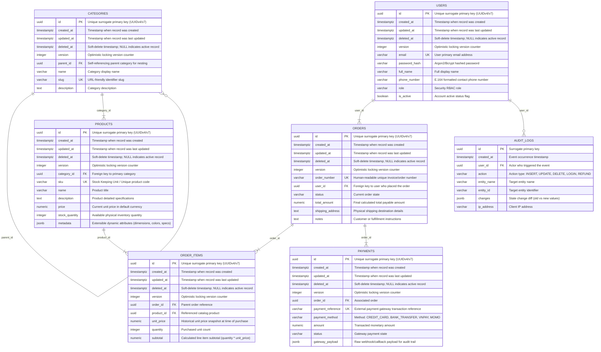

# Entity-Relationship Diagram (ERD): STUDENT_MANAGEMENT_SYSTEM

> [!NOTE]
> **Database Architecture**: student_management_system | Dialect: POSTGRESQL 16+ | Designed by: DBA AI Agent (`dba-01`)

## 1. Visual ER Diagram

---

## 2. Entity Catalog & Domain Breakdown

| Entity / Table Name | Primary Key | Description | Traceability / BA Requirement |
|---|---|---|---|
| `users` | `id` | Core user accounts and authentication credentials | FR-001 |
| `categories` | `id` | Hierarchical item/service classification taxonomy | FR-01 |
| `products` | `id` | Catalog products/items offered for order or service | FR-01 |
| `orders` | `id` | Customer order headers tracking checkout transactions and lifecycle | FR-02 |
| `order_items` | `id` | Individual line items contained within an order | FR-02 |
| `payments` | `id` | Financial transaction records tied to orders | FR-03 |
| `audit_logs` | `id` | Immutable historical log of critical domain events and data alterations | FR-05 |

---

## 3. Relationship Matrix & Integrity Rules

| Parent Entity | Child Entity | Foreign Key Column | Cardinality | ON DELETE Action | Business Semantics |
|---|---|---|---|---|---|
| `categories` | `categories` | `parent_id` -> `id` | `1 : 0..N` | `SET NULL` | Child `categories` belongs to parent `categories` |
| `categories` | `products` | `category_id` -> `id` | `1 : 1..N` | `RESTRICT` | Child `products` belongs to parent `categories` |
| `users` | `orders` | `user_id` -> `id` | `1 : 1..N` | `RESTRICT` | Child `orders` belongs to parent `users` |
| `orders` | `order_items` | `order_id` -> `id` | `1 : 1..N` | `CASCADE` | Child `order_items` belongs to parent `orders` |
| `products` | `order_items` | `product_id` -> `id` | `1 : 1..N` | `RESTRICT` | Child `order_items` belongs to parent `products` |
| `orders` | `payments` | `order_id` -> `id` | `1 : 1..N` | `RESTRICT` | Child `payments` belongs to parent `orders` |
| `users` | `audit_logs` | `user_id` -> `id` | `1 : 0..N` | `SET NULL` | Child `audit_logs` belongs to parent `users` |

---

## 4. Key Design Decisions & Normalization Rationale
- **Surrogate Keys**: Standardized on UUIDv7 / UUIDv4 across all tables for distributed uniqueness and security.
- **Referential Actions**: Mission-critical master records employ `RESTRICT` to prevent accidental orphaned deletions; child composition details (e.g. line items) use `CASCADE`.
- **Audit Standard**: All tables include `created_at`, `updated_at`, `deleted_at` (soft delete), and `version`.