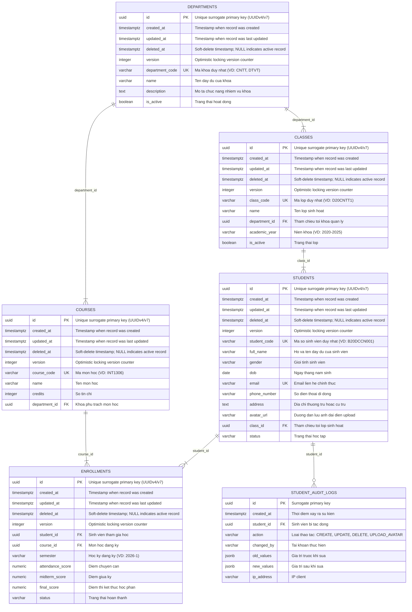

# Entity-Relationship Diagram (ERD): STUDENT_MGMT_DB

> [!NOTE]
> **Database Architecture**: student_mgmt_db | Dialect: POSTGRESQL 16+ | Designed by: DBA AI Agent (`dba-01`)

## 1. Visual ER Diagram

---

## 2. Entity Catalog & Domain Breakdown

| Entity / Table Name | Primary Key | Description | Traceability / BA Requirement |
|---|---|---|---|
| `departments` | `id` | Khoa / Vien dao tao quan ly cac nganh va lop hoc | FR-01 |
| `classes` | `id` | Lop sinh hoat hoc tap theo nien khoa | FR-01 |
| `students` | `id` | Ho so thong tin sinh vien day du kem anh dai dien | FR-02 |
| `courses` | `id` | Hoc phan chuong trinh dao tao | FR-03 |
| `enrollments` | `id` | Dang ky hoc phan va bang diem sinh vien | FR-03 |
| `student_audit_logs` | `id` | Nhat ky kiem toan bat bien ghi lai cac thay doi ho so sinh vien | FR-04 |

---

## 3. Relationship Matrix & Integrity Rules

| Parent Entity | Child Entity | Foreign Key Column | Cardinality | ON DELETE Action | Business Semantics |
|---|---|---|---|---|---|
| `departments` | `classes` | `department_id` -> `id` | `1 : 1..N` | `RESTRICT` | Child `classes` belongs to parent `departments` |
| `classes` | `students` | `class_id` -> `id` | `1 : 1..N` | `RESTRICT` | Child `students` belongs to parent `classes` |
| `departments` | `courses` | `department_id` -> `id` | `1 : 1..N` | `RESTRICT` | Child `courses` belongs to parent `departments` |
| `students` | `enrollments` | `student_id` -> `id` | `1 : 1..N` | `CASCADE` | Child `enrollments` belongs to parent `students` |
| `courses` | `enrollments` | `course_id` -> `id` | `1 : 1..N` | `RESTRICT` | Child `enrollments` belongs to parent `courses` |
| `students` | `student_audit_logs` | `student_id` -> `id` | `1 : 0..N` | `SET NULL` | Child `student_audit_logs` belongs to parent `students` |

---

## 4. Key Design Decisions & Normalization Rationale
- **Surrogate Keys**: Standardized on UUIDv7 / UUIDv4 across all tables for distributed uniqueness and security.
- **Referential Actions**: Mission-critical master records employ `RESTRICT` to prevent accidental orphaned deletions; child composition details (e.g. line items) use `CASCADE`.
- **Audit Standard**: All tables include `created_at`, `updated_at`, `deleted_at` (soft delete), and `version`.