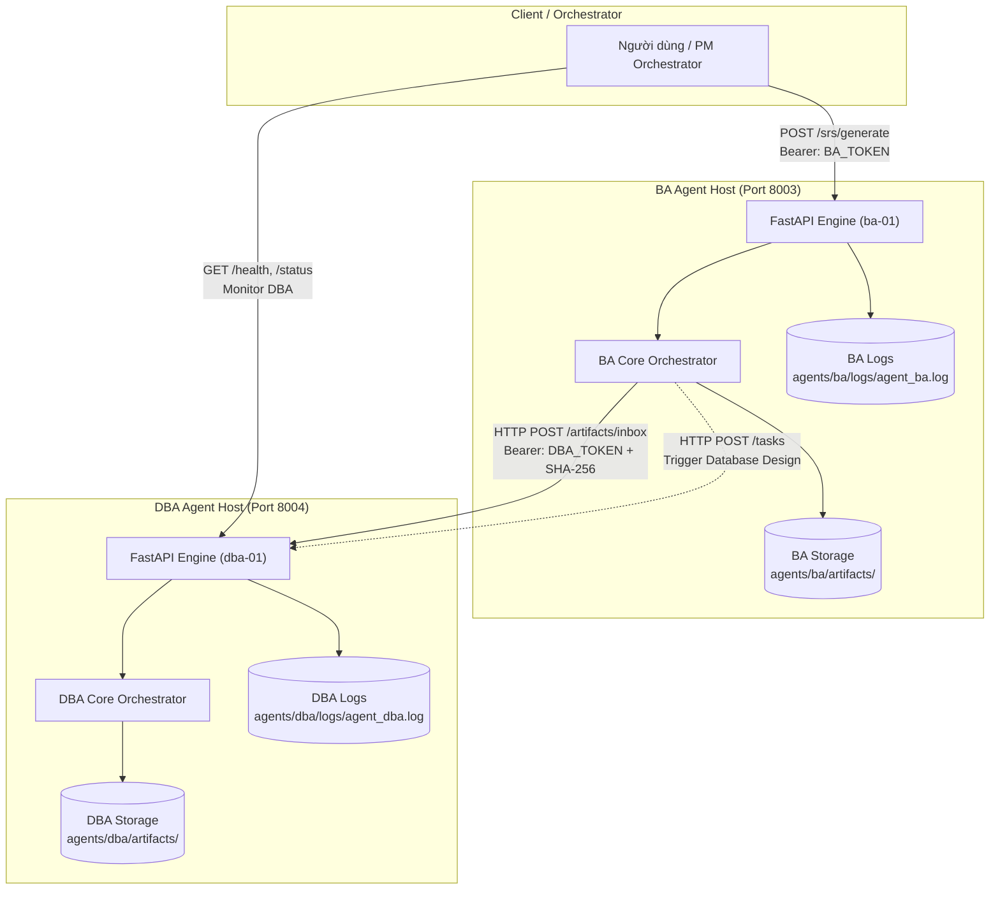
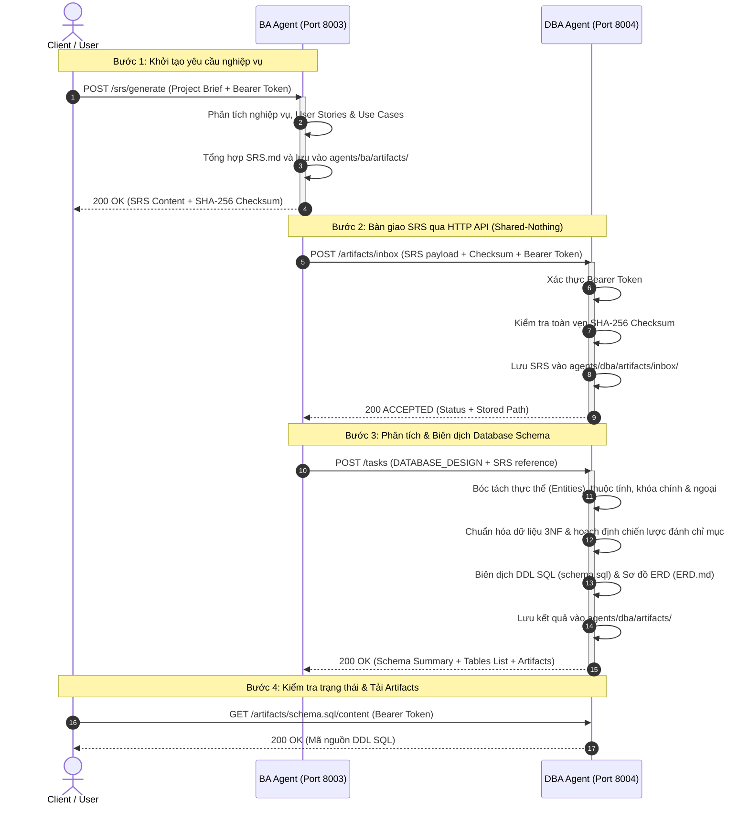

# KIẾN TRÚC HỆ THỐNG MULTI-AGENT BA & DBA
### Multi-Agent System Architecture: Business Analyst (BA) & Database Administrator (DBA)
*Dự án: **agent_BA_DBA** | Chuẩn giao tiếp: **HTTP REST API v1** & **Agent Contract v1.1.0***

---

## 1. TỔNG QUAN HỆ THỐNG VÀ NGUYÊN TẮC CỐT LÕI

Hệ thống bao gồm hai AI Agent chuyên biệt hoạt động độc lập theo mô hình **Microservices / Multi-Agent System**:
- **BA Agent (`ba-01`)**: Hoạt động tại cổng `8003`, chịu trách nhiệm phân tích yêu cầu nghiệp vụ, bóc tách User Stories, Use Cases và tổng hợp tài liệu đặc tả yêu cầu phần mềm (**Software Requirements Specification - SRS**).
- **DBA Agent (`dba-01`)**: Hoạt động tại cổng `8004`, chịu trách nhiệm tiếp nhận tài liệu SRS từ BA Agent, phân tích cấu trúc thực thể, quan hệ dữ liệu, chuẩn hóa 3NF và biên dịch ra Database Schema chuẩn (**ANSI SQL / PostgreSQL DDL** kèm sơ đồ ERD).

### Các nguyên tắc thiết kế cốt lõi:
1. **Kiến trúc Không chia sẻ bộ nhớ/ổ đĩa (Shared-Nothing Architecture)**:
   - Tuyệt đối không sử dụng thư mục dùng chung (shared folder) giữa hai Agent.
   - Mỗi Agent quản lý không gian làm việc (`workspace/`), kho tài liệu (`artifacts/`) và nhật ký (`logs/`) hoàn toàn độc lập và tách biệt.
2. **Giao tiếp hoàn toàn qua HTTP REST API**:
   - Mọi hoạt động trao đổi thông tin, tài liệu và bàn giao công việc giữa BA và DBA được thực hiện 100% qua các HTTP Endpoint chuẩn.
   - Tài liệu chuyển giao được truyền tải dưới dạng payload JSON hoặc Multipart Stream qua giao thức HTTP POST.
3. **Bảo mật và Toàn vẹn dữ liệu (Security & Integrity)**:
   - Mọi API nghiệp vụ được bảo vệ bằng cơ chế xác thực **Bearer Token**.
   - Kiểm tra mã băm SHA-256 tại đầu vào và đầu ra để đảm bảo tài liệu SRS không bị sai lệch hoặc giả mạo khi truyền qua mạng.
4. **Khả năng quan sát toàn diện (Observability)**:
   - Cơ chế ghi log đa kênh: xuất ra console thời gian thực và ghi lưu trữ file log riêng biệt cho từng agent.
   - Middleware ghi lại chi tiết mọi HTTP request (method, endpoint, client IP, mã trạng thái HTTP, thời gian phản hồi miligiây).

---

## 2. SƠ ĐỒ KIẾN TRÚC HỆ THỐNG (SYSTEM TOPOLOGY)



---

## 3. QUY TRÌNH PHỐI HỢP CHI TIẾT (END-TO-END WORKFLOW)

Quy trình tuần tự từ lúc nhận yêu cầu nghiệp vụ thô đến khi xuất ra Database Schema hoàn chỉnh:



---

## 4. ĐẶC TẢ API CỦA TỪNG AGENT

### 4.1. BA Agent API (`http://127.0.0.1:8003`)

| Phương thức | Đường dẫn | Xác thực | Mô tả chức năng |
|---|---|:---:|---|
| `GET` | `/health` | Không | Kiểm tra trạng thái hoạt động công khai (Probe Health). |
| `GET` | `/status` | Bearer Token | Kiểm tra chi tiết trạng thái Agent (IDLE/BUSY), số task hoàn thành, số artifact. |
| `GET` | `/agent` | Bearer Token | Trả về thông tin đặc tả, vai trò, capabilities của BA Agent. |
| `POST` | `/srs/generate` | Bearer Token | Nhận yêu cầu dự án, phân tích và xuất tài liệu SRS chuẩn. |
| `POST` | `/srs/send-to-dba` | Bearer Token | Chuyển giao tài liệu SRS sang DBA Agent qua HTTP API và kích hoạt tạo Schema. |
| `GET` | `/artifacts` | Bearer Token | Liệt kê danh sách tài liệu đặc tả do BA tạo ra trong thư mục artifacts. |
| `GET` | `/artifacts/{filename}` | Bearer Token | Tải về nội dung tài liệu artifact chỉ định (ví dụ `SRS.md`). |
| `POST` | `/artifacts/inbox` | Bearer Token | Tiếp nhận tài liệu đầu vào từ ngoài vào workspace của BA. |

#### Ví dụ Request tạo SRS (`POST /srs/generate`):
```json
{
  "project_name": "Smart Logistics System",
  "description": "Hệ thống quản lý vận đơn và kho bãi thông minh.",
  "features": [
    "Xác thực người dùng và phân quyền RBAC",
    "Quản lý đơn hàng và theo dõi lộ trình",
    "Quản lý vị trí kho và tồn kho theo thời gian thực"
  ],
  "domain": "Logistics & Supply Chain"
}
```

---

### 4.2. DBA Agent API (`http://127.0.0.1:8004`)

| Phương thức | Đường dẫn | Xác thực | Mô tả chức năng |
|---|---|:---:|---|
| `GET` | `/health` | Không | Kiểm tra trạng thái hoạt động công khai. |
| `GET` | `/status` | Bearer Token | Kiểm tra chi tiết trạng thái Agent (IDLE/BUSY), số lượng bảng, số artifact. |
| `GET` | `/agent` | Bearer Token | Trả về năng lực kỹ thuật và danh mục đầu ra bắt buộc của DBA. |
| `POST` | `/artifacts/inbox` | Bearer Token | Tiếp nhận tài liệu SRS từ BA gửi sang (kèm kiểm tra SHA-256). |
| `POST` | `/tasks` | Bearer Token | Tiếp nhận SRS, phân tích thực thể và sinh trọn bộ 6 tài liệu thiết kế CSDL. |
| `POST` | `/schema/generate-from-srs` | Bearer Token | Endpoint chuyên dụng biên dịch trực tiếp DDL SQL từ SRS trong inbox. |
| `GET` | `/artifacts` | Bearer Token | Liệt kê toàn bộ artifacts do DBA tạo ra. |
| `GET` | `/artifacts/{id}/content` | Bearer Token | Tải về nội dung mã nguồn SQL (`schema.sql`) hoặc sơ đồ ERD (`ERD.md`). |

#### Ví dụ Request gửi Artifact vào Inbox (`POST /artifacts/inbox`):
```json
{
  "artifact_id": "SRS.md",
  "type": "SRS_DOCUMENT",
  "created_by": "ba-01",
  "content": "# SOFTWARE REQUIREMENTS SPECIFICATION\n...",
  "checksum": "a3f5b7..."
}
```

---

## 5. CƠ CHẾ XÁC THỰC BẢO MẬT (BEARER TOKEN AUTHENTICATION)

1. **Chuẩn xác thực**:
   - Sử dụng chuẩn Header: `Authorization: Bearer <AGENT_API_KEY>`.
   - Token được cấu hình tập trung tại `config/agents.yaml` hoặc biến môi trường `.env`.
2. **Chống tấn công thời gian (Timing Attack Prevention)**:
   - Quá trình so khớp Token sử dụng thuật toán so sánh chuỗi thời gian cố định `hmac.compare_digest` để chống tấn công phân tích thời gian.
3. **Mã phản hồi HTTP**:
   - `401 Unauthorized`: Khi không truyền Header hoặc Bearer Token không khớp.
   - `422 Unprocessable Entity`: Khi Checksum SHA-256 không trùng khớp với nội dung file truyền tải.

---

## 6. QUẢN LÝ TÀI LIỆU ĐẦU RA (ARTIFACTS LIFECYCLE)

Không có thư mục chia sẻ chung. Mỗi Agent lưu giữ độc lập trong không gian lưu trữ của mình:

### 6.1. BA Artifacts (`agents/ba/artifacts/`)
- `SRS.md`: Tài liệu đặc tả yêu cầu phần mềm đầy đủ theo chuẩn IEEE 830.
- `REQUIREMENTS.md`: Bảng phân loại yêu cầu chức năng (FR) và phi chức năng (NFR).
- `USER_STORIES.md`: Danh sách User Stories theo tiêu chí INVEST.
- `USE_CASES.md`: Đặc tả Use Cases chi tiết kèm luồng chính (Main Flow) và luồng phụ.
- `ACCEPTANCE_CRITERIA.md`: Bộ tiêu chí nghiệm thu viết bằng cú pháp Gherkin (Given/When/Then).
- `BUSINESS_PROCESS.md`: Mô hình hóa quy trình nghiệp vụ.

### 6.2. DBA Artifacts (`agents/dba/artifacts/`)
- `schema.sql`: Kịch bản DDL SQL đầy đủ (CREATE TABLE, PRIMARY KEY, FOREIGN KEY, NOT NULL, UNIQUE, CHECK).
- `ERD.md`: Sơ đồ quan hệ thực thể trực quan bằng cú pháp Mermaid `erDiagram`.
- `DATABASE_DESIGN.md`: Tài liệu kiến trúc thiết kế CSDL, giải thích chuẩn hóa 3NF.
- `DATA_REQUIREMENTS.md`: Từ điển dữ liệu (Data Dictionary) và ràng buộc toàn vẹn.
- `INDEX_STRATEGY.md`: Chiến lược đánh chỉ mục hiệu năng cao (B-Tree, Partial Index, Composite Index).
- `DATABASE_REVIEW.md`: Đánh giá rà soát chất lượng thiết kế CSDL và phòng ngừa Anti-patterns.

---

## 7. CƠ CHẾ GHI NHẬT KÝ (LOGGING & OBSERVABILITY)

- **Cấu hình**: Triển khai qua `setup_logger` trong `agents/ba/logger.py` và `agents/dba/logger.py`.
- **Định dạng chuẩn**: `[YYYY-MM-DD HH:MM:SS] [LEVEL] [agent_id] [Thông điệp]`
- **Kênh xuất dữ liệu (Dual Channel)**:
  1. *Console*: Xuất ra terminal phục vụ giám sát trực tiếp.
  2. *File log*: Ghi tự động vào `agents/ba/logs/agent_ba.log` và `agents/dba/logs/agent_dba.log`.
- **Request Tracing**: Middleware HTTP tự động ghi nhận mọi truy cập:
  ```text
  [2026-11-04 22:15:00] [INFO] [agent.ba-01] HTTP POST /srs/generate - Status: 200 (15.2ms) [Client: 127.0.0.1]
  [2026-11-04 22:15:01] [INFO] [agent.dba-01] HTTP POST /artifacts/inbox - Status: 200 (8.1ms) [Client: 127.0.0.1]
  ```

---

## 8. HƯỚNG DẪN VẬN HÀNH VÀ KIỂM THỬ

### 8.1. Khởi động đồng thời cả 2 Agent
```powershell
python scripts/start_agents.py
```
Script sẽ khởi chạy:
- BA Agent tại `http://127.0.0.1:8003`
- DBA Agent tại `http://127.0.0.1:8004`
- Tự động kiểm tra trạng thái sức khỏe `/health` trước khi sẵn sàng tiếp nhận request.

### 8.2. Chạy kiểm thử tự động toàn bộ luồng tích hợp
Mở một cửa sổ terminal khác và chạy:
```powershell
python scripts/test_connection.py
```
Script sẽ thực hiện kiểm tra 7 giai đoạn:
1. Health Probes trên cả 2 agent.
2. Kiểm tra từ chối 401 khi thiếu/sai token, chấp nhận 200 khi có Bearer token.
3. Kiểm tra API trạng thái hoạt động (State & Metrics).
4. Ra lệnh cho BA Agent phân tích và sinh tài liệu SRS (`POST /srs/generate`).
5. Truyền tải tài liệu SRS sang DBA Agent qua HTTP API (kiểm tra tính toàn vẹn Checksum SHA-256).
6. Ra lệnh cho DBA Agent phân tích SRS và biên dịch ra Database Schema (`schema.sql`).
7. Xác thực sự tồn tại và tính hợp lệ của toàn bộ artifacts trên ổ đĩa.
